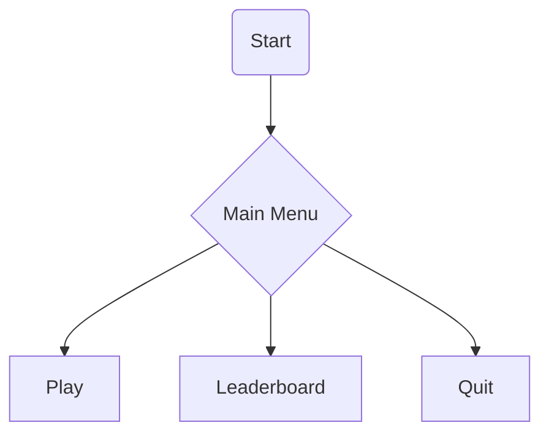
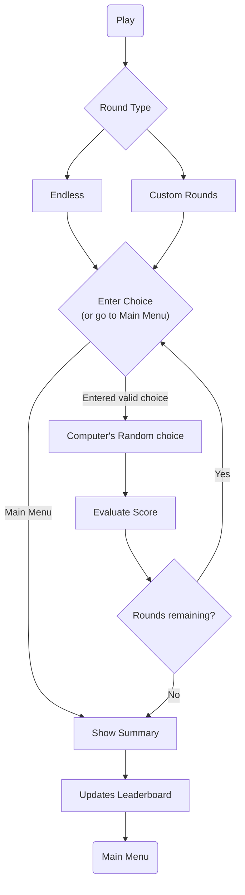
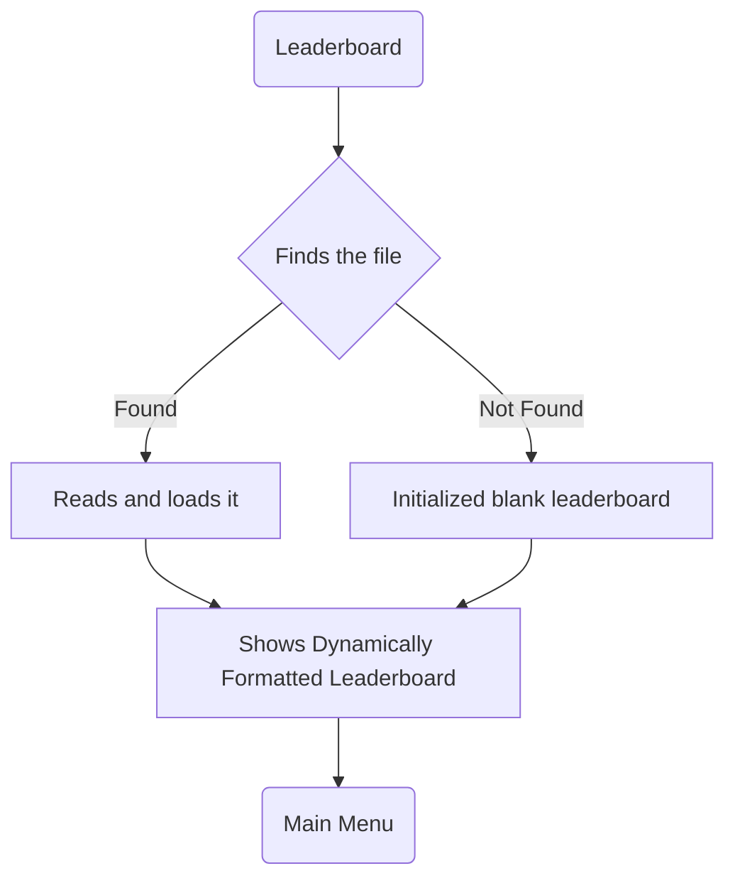

# Console Based Game
## Rock Paper Scissor

A Console-Based Rock-Paper-Scissor game. 

<u>From HackClub? Click on this</u>

So you are from HackClub, I am glad that you are on my repository, thank you.

You may have some questions about this project, first maybe why it took you quite a long time to developed this project and why your tracking is in multiple folders?

The reason it took me so long is that I didn't used any AI, I have written code after at least 1 year later, I wrote multiple versions and scraped them(mostly experimenting as it is my first C++ code), the one mistake I did was not setuping the project earlier properly, i was renaming the folder multiple times, not just it i even changed the repo thats why all the commits of developing are gone.

I hope you understand this and clears my project.

Thank You!

## 📌 Quick Start
### Windows: 
Download `game.exe` and enjoy your game!

### Linux & Mac:
Download the `game.cpp`, compile the C++ file and enjoy your game!

---

## ⚙ Program Flow

<i><u>Diagram Issue?</u></i>

These are Mermaid diagrams, you may need extension to render it. For VS code, use this extension: https://marketplace.visualstudio.com/items?itemName=bierner.markdown-mermaid

### 🔰 Main Menu 
The starting point of the game, play can choose to "Play", "Show Leaderboard", or can quit the game.

<b><u>Click here to see "Main Menu" Flow</u></b>

### 🧩 Play 

When player choosed to Play, he will have two game modes:

- **Game Modes:**
    1. **Endless:** A very big finite interger, delusion of infinity.
    2. **Custom Rounds:** Player will have to enter any positive integer number

After choosing game mode, player needs to either enter a valid game choice:

1. Rock
2. Paper
3. Scissor
4. Go to Main Menu

After completing all the rounds or decided to go to main menu, game will show a **Summary** of the player's game, updates the **Leaderboard** accordingly and goes back to Main Menu. 

<b><u>Click here to see "Play" Flow</u></b>

### 📊 Leaderboard
Game will search `FILE_NAME`, if it founds it, it will read and load it else it will make a blank file containing blank `Player` structure. Then it will show a dynamically-formattted table in descending order(based on number of wins) in terminal.

Number of entities for the Leaderboard is controlled via `MAX_ENTRIES`

A `leaderboard.txt` is also added as Demo, entries are stored in CSV format.

> Bubble sort is used to sort the leaderboard in descending order based on number of wins.

<b><u>Click here to see "Leaderboard" Flow</u></b>

---

### Technical Details
Developed in C++ by Saadullah Khan

---
